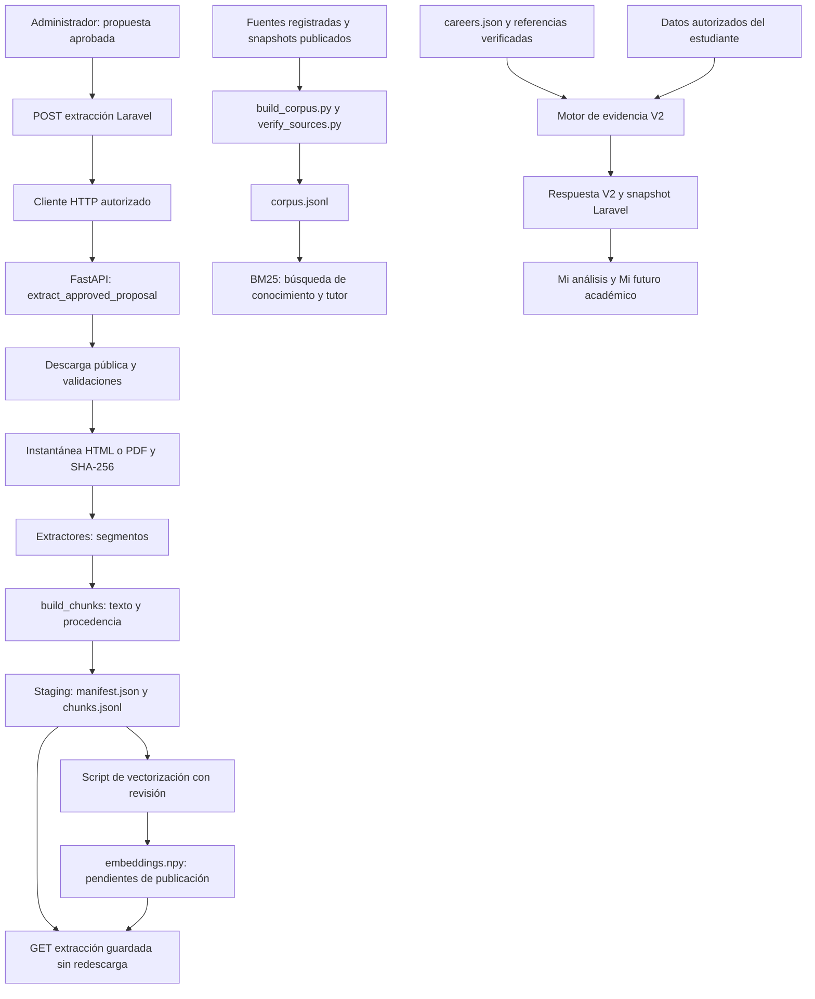
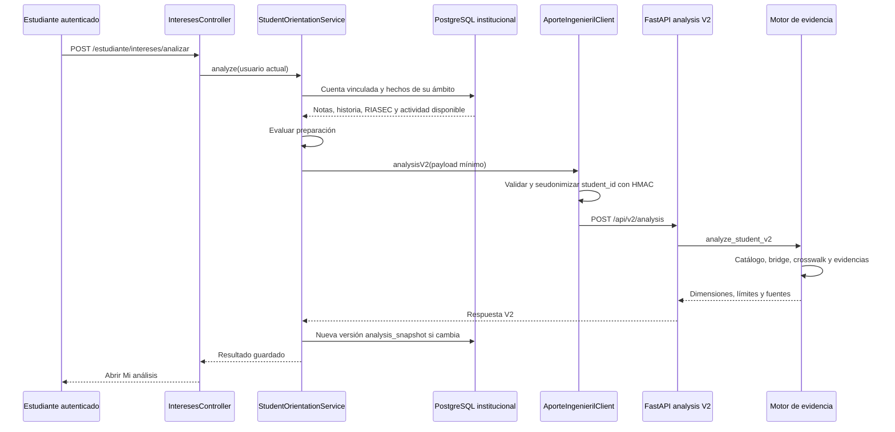
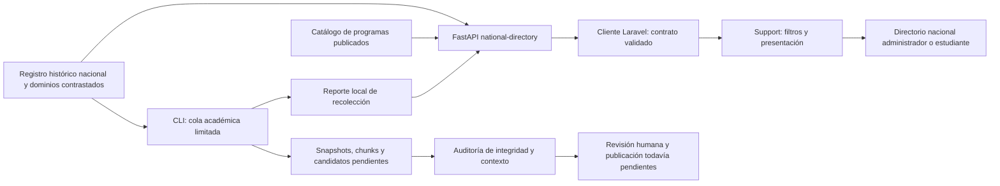

# Extracción, conocimiento nacional y estudio del estudiante

Verificación del código, catálogo local y consulta del directorio: **8 de octubre de 2026**, checkout `C:/laragon/www/savp-reestructuracion`. Las referencias enlazan el archivo y la línea inicial de cada bloque. Los rangos escritos permiten localizar su final. La consulta real Laravel→FastAPI del directorio fue comprobada; esta evidencia no acredita vigencia de toda la oferta ni QA visual del navegador.

## 1. Qué existe y dónde termina cada paso

El recorrido implementado tiene dos entradas independientes: administración incorpora documentos públicos aprobados a una zona de revisión; el estudiante solicita un análisis con sus datos autorizados y un catálogo versionado. **Extraer y vectorizar una propuesta no la publica automáticamente ni la convierte en evidencia del estudio.**

| Artefacto | Uso actual | Código exacto |
|---|---|---|
| Propuesta aprobada | Habilita la extracción de su URL registrada | [`academic_ingestion.py:71–81`](/C:/laragon/www/savp-reestructuracion/ai-service/app/knowledge/academic_ingestion.py:71) |
| Instantánea, chunks y manifiesto de revisión | Permiten inspeccionar texto, procedencia, hechos candidatos y vectores | [`academic_ingestion.py:348–455`](/C:/laragon/www/savp-reestructuracion/ai-service/app/knowledge/academic_ingestion.py:348) |
| Embeddings revisados | Se guardan en staging con estado `GENERADOS_PENDIENTES_PUBLICACION` | [`vector_staging.py:218–239`](/C:/laragon/www/savp-reestructuracion/ai-service/app/knowledge/vector_staging.py:218) |
| Corpus publicado | Lo carga el recuperador lexical BM25 | [`retrieval/index.py:6–14`](/C:/laragon/www/savp-reestructuracion/ai-service/app/retrieval/index.py:6), [`retrieval/service.py:18–30`](/C:/laragon/www/savp-reestructuracion/ai-service/app/retrieval/service.py:18) |
| Catálogo de carreras | Determina las carreras elegibles y las referencias externas del análisis | [`registry.py:12`](/C:/laragon/www/savp-reestructuracion/ai-service/app/knowledge/registry.py:12), [`evidence_engine.py:753–793`](/C:/laragon/www/savp-reestructuracion/ai-service/app/recommendation/evidence_engine.py:753) |
| `analysis_snapshot` | Conserva una versión del estudio para las vistas del estudiante | [`StudentOrientationService.php:209–244`](/C:/laragon/www/savp-reestructuracion/app/Services/AporteIngenieril/StudentOrientationService.php:209) |

La ausencia de flecha entre staging y corpus/catálogo refleja una separación real del código: los endpoints de extracción escriben staging, mientras el constructor del corpus lee `sources.json` y el motor V2 lee `careers.json`. La promoción revisada de una propuesta nueva a esos registros requiere una operación adicional; no hay un endpoint de publicación en este recorrido.

## 2. Extracción: de la ruta al texto

1. **Autorización y transporte Laravel.** `POST /conocimiento/fuentes/{proposalId}/extraccion` inicia una extracción; `GET` en esa misma ruta consulta la extracción guardada. Ambas exigen Administrador y `conocimiento.revisar`; sus límites son 3 y 30 solicitudes por minuto, respectivamente. Referencia: [`routes/web.php:32–50`](/C:/laragon/www/savp-reestructuracion/routes/web.php:32).
2. **Propuesta, no URL arbitraria.** `ConocimientoUniversitarioController::extraer` rechaza campos extra, consulta gobernanza y exige `APROBADA_PENDIENTE_INGESTA`. En líneas 241–243 elige `readKnowledgeExtraction` para GET y `extractKnowledgeSource` para POST. Referencia: [`ConocimientoUniversitarioController.php:220–251`](/C:/laragon/www/savp-reestructuracion/app/Http/Controllers/ConocimientoUniversitarioController.php:220).
3. **Cliente HTTP.** Envía GET/POST a `/api/v1/knowledge/governance/proposals/{id}/extract`: [`AporteIngenierilClient.php:75–90`](/C:/laragon/www/savp-reestructuracion/app/Services/AporteIngenieril/AporteIngenierilClient.php:75). Comprueba host y contrato, añade `X-SAVP-AI-Key` y aplica timeout de extracción de 30 s: [`AporteIngenierilClient.php:118–174`](/C:/laragon/www/savp-reestructuracion/app/Services/AporteIngenieril/AporteIngenierilClient.php:118).
4. **Endpoint Python.** POST llama a `extract_approved_proposal`; GET llama a `read_approved_extraction`. Los errores de propuesta inexistente o estado incompatible se traducen a 404/409. Referencia: [`api/v1/knowledge.py:115–142`](/C:/laragon/www/savp-reestructuracion/ai-service/app/api/v1/knowledge.py:115).
5. **Descarga controlada.** La ingesta solicita un documento de hasta 12 MiB, exige HTTP 200, documento público y formato HTML/PDF coherente con lo aprobado: [`academic_ingestion.py:259–302`](/C:/laragon/www/savp-reestructuracion/ai-service/app/knowledge/academic_ingestion.py:259). La descarga admite hasta cuatro iteraciones de redirección y conserva la universidad reconocida: [`source_preview.py:235–249`](/C:/laragon/www/savp-reestructuracion/ai-service/app/knowledge/source_preview.py:235).
6. **Instantánea y segmentos.** SHA-256 identifica los bytes recibidos; se escribe `instantanea.html` o `instantanea.pdf`. PDF extrae texto digital con PyMuPDF y señala las páginas que necesitan OCR; el OCR automático está deshabilitado. HTML elimina scripts y navegación y segmenta contenido por secciones. Referencias: [`academic_ingestion.py:348–361`](/C:/laragon/www/savp-reestructuracion/ai-service/app/knowledge/academic_ingestion.py:348), [`extractors.py:30–102`](/C:/laragon/www/savp-reestructuracion/ai-service/app/ingestion/extractors.py:30).
7. **Hechos candidatos.** `_facts` identifica únicamente `DURACION`, `CARRERA` y `MATERIA` mediante texto presente; conserva evidencia, página, sección y URL, deduplica y limita a 60 candidatos. No extrae costos ni acredita automáticamente vigencia o una oferta de otra sede. Referencia: [`academic_ingestion.py:85–153`](/C:/laragon/www/savp-reestructuracion/ai-service/app/knowledge/academic_ingestion.py:85).

La extracción revisa hasta **80 páginas PDF**, devuelve hasta **8 chunks de vista previa** y lee **un documento**. Puede sugerir hasta tres enlaces académicos adicionales, pero no los descarga. `maximum_documents: 4` expresa el límite declarado de cobertura y no cuatro descargas realizadas. Referencias: [`academic_ingestion.py:39–41`](/C:/laragon/www/savp-reestructuracion/ai-service/app/knowledge/academic_ingestion.py:39), [`academic_ingestion.py:344–347`](/C:/laragon/www/savp-reestructuracion/ai-service/app/knowledge/academic_ingestion.py:344), [`academic_ingestion.py:433`](/C:/laragon/www/savp-reestructuracion/ai-service/app/knowledge/academic_ingestion.py:433), [`source_preview.py:473–553`](/C:/laragon/www/savp-reestructuracion/ai-service/app/knowledge/source_preview.py:473).

## 3. Chunks, embeddings y publicación

### 3.1 División del texto

[`chunking.py:33–85`](/C:/laragon/www/savp-reestructuracion/ai-service/app/ingestion/chunking.py:33) usa bloques objetivo de **1200 caracteres** y solapamiento de **180 caracteres**. Son caracteres, no tokens de un modelo. El ID es un SHA-256 truncado a 24 caracteres de fuente, página, sección, ordinal y texto. Cada chunk conserva institución, URL, fecha, hash documental, versión y método de extracción; esto permite remontar el resultado a su documento.

[`academic_ingestion.py:389–455`](/C:/laragon/www/savp-reestructuracion/ai-service/app/knowledge/academic_ingestion.py:389) marca la fuente `STAGED_REVIEW`/`PENDING_HUMAN_REVIEW` y guarda manifiesto y `chunks.jsonl` mediante archivos temporales y `os.replace`. Su carpeta deriva del registro de propuestas: [`academic_ingestion.py:156–160`](/C:/laragon/www/savp-reestructuracion/ai-service/app/knowledge/academic_ingestion.py:156).

### 3.2 Vectorización real, todavía separada de la recuperación

El script [`vectorizar_fuente_revisada.py:10–23`](/C:/laragon/www/savp-reestructuracion/ai-service/scripts/vectorizar_fuente_revisada.py:10) exige propuesta, directorio local del modelo, revisor y nota de revisión. [`vector_staging.py:166–208`](/C:/laragon/www/savp-reestructuracion/ai-service/app/knowledge/vector_staging.py:166) verifica staging, carga SentenceTransformer en CPU con `local_files_only=True`, `trust_remote_code=False` y pesos safetensors; codifica `passage: ` + texto en lotes de 16.

Se exige un vector normalizado de **384 dimensiones por chunk** y valores finitos. Antes de guardar se vuelve a comprobar que documento y chunks no hayan cambiado. Se registran hashes del modelo, chunks y vectores junto con revisor y justificación: [`vector_staging.py:201–239`](/C:/laragon/www/savp-reestructuracion/ai-service/app/knowledge/vector_staging.py:201). Esto verifica integridad técnica, no calidad semántica ni publicación.

### 3.3 Recuperación activa y promoción pendiente

[`retrieval/service.py:18–30`](/C:/laragon/www/savp-reestructuracion/ai-service/app/retrieval/service.py:18) devuelve `LexicalRetriever(load_corpus())` y declara `embedding_model: NONE`. [`retrieval/hybrid.py:108–143`](/C:/laragon/www/savp-reestructuracion/ai-service/app/retrieval/hybrid.py:108) calcula BM25 y filtra institución, tipo documental y oficialidad. El nombre histórico `hybrid.py` no implica que hoy consulte un índice denso o FAISS.

El corpus publicado se construye desde `sources.json` y sus archivos locales con [`build_corpus.py:29–35`](/C:/laragon/www/savp-reestructuracion/ai-service/scripts/build_corpus.py:29) y [`build_corpus.py:118–153`](/C:/laragon/www/savp-reestructuracion/ai-service/scripts/build_corpus.py:118). `--source-id` con `--merge-existing` permite reprocesar fuentes concretas y conservar otras, exigiendo concordancia de hashes: [`build_corpus.py:18–25`](/C:/laragon/www/savp-reestructuracion/ai-service/scripts/build_corpus.py:18), [`build_corpus.py:63–76`](/C:/laragon/www/savp-reestructuracion/ai-service/scripts/build_corpus.py:63).

[`verify_sources.py:31–60`](/C:/laragon/www/savp-reestructuracion/ai-service/scripts/verify_sources.py:31) comprueba snapshots y hashes; [`verify_sources.py:96–135`](/C:/laragon/www/savp-reestructuracion/ai-service/scripts/verify_sources.py:96) comprueba chunks huérfanos/duplicados, fuentes externas filtradas al corpus, conteos y versión/hash. No promueve automáticamente staging ni verifica un índice vectorial operativo. Para una nueva publicación también debe actualizarse el catálogo y, si corresponde, las relaciones del bridge/crosswalk con respaldo revisado. El catálogo valida los IDs de evidencia: [`registry.py:255–275`](/C:/laragon/www/savp-reestructuracion/ai-service/app/knowledge/registry.py:255).

## 4. Del catálogo al estudio individual

| Paso | Código verificable |
|---|---|
| Rutas del estudiante y permiso | [`routes/estudiante.php:20–31`](/C:/laragon/www/savp-reestructuracion/routes/estudiante.php:20) |
| Prohibir `student_id` enviado por el navegador y usar usuario actual | [`InteresesController.php:127–145`](/C:/laragon/www/savp-reestructuracion/app/Http/Controllers/Estudiante/InteresesController.php:127) |
| Exigir cuenta estudiantil vinculada y autorización | [`StudentOrientationService.php:30–44`](/C:/laragon/www/savp-reestructuracion/app/Services/AporteIngenieril/StudentOrientationService.php:30) |
| Reunir notas vigentes/rectificadas, historia, RIASEC vigente, especialidad, asistencia y entregas disponibles | [`StudentOrientationService.php:58–124`](/C:/laragon/www/savp-reestructuracion/app/Services/AporteIngenieril/StudentOrientationService.php:58) |
| Bloquear perfil sin preparación; enviar análisis | [`StudentOrientationService.php:209–217`](/C:/laragon/www/savp-reestructuracion/app/Services/AporteIngenieril/StudentOrientationService.php:209) |
| HMAC antes del transporte; Python recibe referencia seudónima | [`AporteIngenierilClient.php:151–153`](/C:/laragon/www/savp-reestructuracion/app/Services/AporteIngenieril/AporteIngenierilClient.php:151) |
| Endpoint protegido por clave | [`api/v2/analysis.py:7–12`](/C:/laragon/www/savp-reestructuracion/ai-service/app/api/v2/analysis.py:7) |
| Cálculos y orquestación V2 | [`student_profile_v2.py:128–157`](/C:/laragon/www/savp-reestructuracion/ai-service/app/domain/student_profile_v2.py:128) |
| Perfiles de carreras elegibles, usando catálogo, bridge y crosswalk | [`evidence_engine.py:753–800`](/C:/laragon/www/savp-reestructuracion/ai-service/app/recommendation/evidence_engine.py:753) |
| Fuentes externas informativas separadas | [`student_profile_v2.py:87–125`](/C:/laragon/www/savp-reestructuracion/ai-service/app/domain/student_profile_v2.py:87) |
| Verificar cambios concurrentes de perfil/gestión y guardar una nueva versión | [`StudentOrientationService.php:220–244`](/C:/laragon/www/savp-reestructuracion/app/Services/AporteIngenieril/StudentOrientationService.php:220) |
| Mostrar el estudio guardado | [`InteresesController.php:31–37`](/C:/laragon/www/savp-reestructuracion/app/Http/Controllers/Estudiante/InteresesController.php:31), [`analisis.blade.php:6–11`](/C:/laragon/www/savp-reestructuracion/resources/views/estudiante/orientacion/analisis.blade.php:6) |
| Explorar universidades/carreras desde ese snapshot | [`FuturoAcademicoController.php:12–22`](/C:/laragon/www/savp-reestructuracion/app/Http/Controllers/Estudiante/FuturoAcademicoController.php:12), [`futuro.blade.php:15–64`](/C:/laragon/www/savp-reestructuracion/resources/views/estudiante/orientacion/futuro.blade.php:15) |

**No existe en este recorrido una predicción probabilística del éxito, aprobación o deserción.** El motor declara que V2 no produce ranking global ni porcentaje de compatibilidad: [`evidence_engine.py:795–799`](/C:/laragon/www/savp-reestructuracion/ai-service/app/recommendation/evidence_engine.py:795). La respuesta incluye `NO_SUCCESS_PROBABILITY` y `DECISION_SUPPORT_ONLY`: [`student_profile_v2.py:275–284`](/C:/laragon/www/savp-reestructuracion/ai-service/app/domain/student_profile_v2.py:275). Los embeddings no calculan por sí mismos preparación académica, intereses ni oportunidades de admisión.

## 5. Directorio nacional visible y cobertura documentada

Lectura del catálogo local `bo-careers-1.3.0` mediante `load_career_catalog()`: **6 universidades, 12 carreras, 8 elegibles y 4 informativas**; sus ciudades registradas son **La Paz y El Alto**. El modelo aplica `recommendation_eligible=True` cuando el JSON omite ese campo, por lo que contar únicamente los valores explícitos del archivo daría un total incorrecto. Es una instantánea local, no un censo nacional ni una comprobación de oferta vigente en los portales. Fuentes: [`careers.json:1`](/C:/laragon/www/savp-reestructuracion/ai-service/data/catalog/careers.json:1), [`registry.py:166`](/C:/laragon/www/savp-reestructuracion/ai-service/app/knowledge/registry.py:166).

| Necesidad | Estado implementado | Lo necesario para ampliarlo |
|---|---|---|
| Instituciones/departamentos | El registro nacional contiene instituciones, departamentos y sedes históricas; el catálogo del estudio mantiene `name`, `campus`, `city` | Reconciliar el registro histórico con autorización y oferta actuales por sede y gestión |
| Régimen pública/privada/especial/indígena | El registro nacional permite filtrar régimen; la pantalla conserva diferencias documentadas de régimen y financiación | No reducir afiliación al CEUB a propiedad privada ni deducir gratuidad de régimen público |
| Costos | No hay costo en `Career` ni hecho `COSTO` en la ingesta | Arancel público con moneda, concepto, periodicidad, sede, gestión, fecha y fuente. Ausencia debe mostrarse como por verificar, no cero |
| Duración | `duration_text`/`duration_semesters` existen en `Career`; `_facts` detecta duración textual | Confirmar carrera y sede, incorporar tras revisión y conservar versión/vigencia |
| Malla completa | Se ofrecen materias iniciales documentadas o el enlace curricular; no se infieren materias ausentes | Estructurar semestres/asignaturas desde malla oficial revisada antes de afirmar cobertura completa |
| Explorar sin estudio previo | El directorio nacional consulta el registro y programas publicados sin `analysis_snapshot`; exige estudiante vinculado y permiso existente | Mantener el catálogo del estudio separado de la exploración pública documental |

Referencias estructurales: [`registry.py:139–166`](/C:/laragon/www/savp-reestructuracion/ai-service/app/knowledge/registry.py:139), [`academic_ingestion.py:44–50`](/C:/laragon/www/savp-reestructuracion/ai-service/app/knowledge/academic_ingestion.py:44), [`evidence_engine.py:318–357`](/C:/laragon/www/savp-reestructuracion/ai-service/app/recommendation/evidence_engine.py:318). La vista presenta duración y grado o «Por verificar»: [`futuro.blade.php:191`](/C:/laragon/www/savp-reestructuracion/resources/views/estudiante/orientacion/futuro.blade.php:191). El modo `all` de esa pantalla recorre las opciones presentes en el snapshot; no realiza una búsqueda nacional adicional.

### 5.1 Consulta nacional independiente del estudio

`universidades_bolivia.json` registra **60 instituciones nominales de la guía ministerial de 2016**. No acredita que las 60 estén vigentes hoy: contrasta la cifra posterior de 57 sin deducir instituciones excluidas por resta, identifica sedes históricas y separa identidad del dominio de vigencia legal. El registro conserva fuentes, diferencias de cobertura y estados de verificación: [`universidades_bolivia.json:1`](/C:/laragon/www/savp-reestructuracion/ai-service/data/catalog/universidades_bolivia.json:1). La cantidad de dominios y documentos cambia con la verificación; la interfaz lee sus estadísticas actuales y no fija esos valores en Blade.

Al cierre de esta sesión se contrastaron **51 identidades institucionales de sitios web**; la lista de confianza admite **52 dominios**, incluyendo ámbitos de respaldo. Son magnitudes diferentes: `statistics.domains_verified` cuenta instituciones con web contrastada, no dominios únicos ni universidades con vigencia legal confirmada. La interfaz usa la etiqueta «Instituciones con web contrastada» para conservar esa diferencia.

| Bloque de código | Responsabilidad |
|---|---|
| [`catalogo_nacional.py:46`](/C:/laragon/www/savp-reestructuracion/ai-service/app/knowledge/catalogo_nacional.py:46) | Lee registro y cobertura, añade únicamente programas elegibles ya publicados del catálogo, con fuentes y duración; no convierte candidatos recién recolectados en carreras |
| [`api/v1/knowledge.py:43`](/C:/laragon/www/savp-reestructuracion/ai-service/app/api/v1/knowledge.py:43) | GET `/api/v1/knowledge/national-directory`, bajo la clave del servicio |
| [`AporteIngenierilClient.php:41`](/C:/laragon/www/savp-reestructuracion/app/Services/AporteIngenieril/AporteIngenierilClient.php:41), [`AporteIngenierilClient.php:303`](/C:/laragon/www/savp-reestructuracion/app/Services/AporteIngenieril/AporteIngenierilClient.php:303) | Consume y valida el contrato sin enviar datos del alumno |
| [`routes/web.php:32`](/C:/laragon/www/savp-reestructuracion/routes/web.php:32) | `/conocimiento/directorio-nacional`, Administrador/Director y `conocimiento.ver` |
| [`routes/estudiante.php:32`](/C:/laragon/www/savp-reestructuracion/routes/estudiante.php:32) | `/estudiante/directorio-nacional`, actor Estudiante y `Orientacion_Academica_Profesional` |
| [`DirectorioNacionalController.php:13`](/C:/laragon/www/savp-reestructuracion/app/Http/Controllers/DirectorioNacionalController.php:13) | Usa `StudentOrientationService::student()` para exigir vínculo; valida filtros y conserva el shell correspondiente, sin nuevas tablas |
| [`DirectorioNacional.php:18`](/C:/laragon/www/savp-reestructuracion/app/Support/Conocimiento/DirectorioNacional.php:18) | Filtra departamento, régimen, nombre/programa, duración conocida y evidencia económica; ordena por nombre/departamento y humaniza estados y fecha de Bolivia |
| [`directorio-nacional.blade.php:1`](/C:/laragon/www/savp-reestructuracion/resources/views/conocimiento/directorio-nacional.blade.php:1) | Reutiliza tokens, `x-selector-institucional` y `x-plegable-institucional`; muestra cobertura parcial, fuentes, fallo recuperable y resultado vacío explicado |

El filtro «Con montos verificados» exige estado económico `VERIFICADO` y evidencia económica no vacía. El contrato actual publica `PENDIENTE_VERIFICACION` y `economic_evidence: []`: no hay montos aprobados y el filtro devuelve una ausencia explicada. La interfaz no convierte «pública» en «gratuita» ni candidatos económicos en aranceles actuales. La duración se filtra solamente entre programas ya documentados; una institución sin programas publicados todavía puede aparecer al explorar el registro histórico.

La propuesta administrativa de fuentes usa el mismo registro nacional contrastado. [`FuenteUniversitariaInteligente.php:184`](/C:/laragon/www/savp-reestructuracion/app/Support/Conocimiento/FuenteUniversitariaInteligente.php:184) lee el JSON local y conserva los siete dominios de respaldo; complementa solamente entradas `OFFICIAL_DOMAIN_VERIFIED`, excluye `QUARANTINE_SITE_REVIEW_REQUIRED` y valida dominios ASCII sin esquema ni IP. Incorpora sigla y nombre como alias. `contratoParaInterfaz()` y `universidad()` consumen la misma lista, por lo que la prevención del formulario y la validación Laravel tienen la misma identidad institucional. `errorUrl()` bloquea expresamente el sitio UBI en cuarentena, aunque el dominio termine en `.bo`. **Identidad del dominio no equivale a contenido aprobado:** cada propuesta sigue necesitando comprobar documento académico público, carrera/sede, fechas y revisión; una entrada histórica sin contraste actual no recibe autorización automática de extracción.

### 5.2 Recolección nacional y auditoría preliminar

La CLI [`extraer_catalogo_nacional.py:20`](/C:/laragon/www/savp-reestructuracion/ai-service/scripts/extraer_catalogo_nacional.py:20) ofrece catálogo, carpeta de salida, instituciones concretas y límites. [`ingesta_nacional.py:61`](/C:/laragon/www/savp-reestructuracion/ai-service/app/knowledge/ingesta_nacional.py:61) establece límites de documentos, profundidad, cola, hosts, bytes, páginas PDF, chunks, intentos y tiempo; no solicita APIs privadas ni modelos de inferencia.

El recorrido exacto es `NationalCrawler.run()` → `_seed()`/`_enqueue()` → `_visit()` → `_extract()` → `coverage()`:

- [`ingesta_nacional.py:615`](/C:/laragon/www/savp-reestructuracion/ai-service/app/knowledge/ingesta_nacional.py:615) obtiene un bloqueo de archivo y reanuda `estado.json`; recupera intentos interrumpidos.
- [`ingesta_nacional.py:357`](/C:/laragon/www/savp-reestructuracion/ai-service/app/knowledge/ingesta_nacional.py:357) carga las semillas y bloquea instituciones sin dominio contrastado o en cuarentena.
- [`ingesta_nacional.py:100`](/C:/laragon/www/savp-reestructuracion/ai-service/app/knowledge/ingesta_nacional.py:100) canonicaliza URLs permitidas; [`ingesta_nacional.py:213`](/C:/laragon/www/savp-reestructuracion/ai-service/app/knowledge/ingesta_nacional.py:213) descubre enlaces académicos acotados del ámbito permitido.
- [`ingesta_nacional.py:442`](/C:/laragon/www/savp-reestructuracion/ai-service/app/knowledge/ingesta_nacional.py:442) deduplica bytes por SHA-256 y guarda instantánea, fragmentos trazables, manifiesto y candidatos; no escribe el corpus aprobado ni vectoriza.
- [`ingesta_nacional.py:229`](/C:/laragon/www/savp-reestructuracion/ai-service/app/knowledge/ingesta_nacional.py:229) recoge candidatos de carrera, malla/plan, duración, costo publicado, beca, perfil profesional y sede. Son indicios que requieren revisar contexto, carrera, sede, moneda, concepto y vigencia.
- [`ingesta_nacional.py:691`](/C:/laragon/www/savp-reestructuracion/ai-service/app/knowledge/ingesta_nacional.py:691) informa documentos con texto, pendientes, errores y candidatos por institución. `valid` significa texto extraído, no aprobación curricular.

[`auditar_catalogo_nacional.py:68`](/C:/laragon/www/savp-reestructuracion/ai-service/scripts/auditar_catalogo_nacional.py:68) audita los manifiestos, procedencia, hash, fragmentos, contaminación y contexto de candidatos. Produce `auditoria.json`; [`auditar_catalogo_nacional.py:356`](/C:/laragon/www/savp-reestructuracion/ai-service/scripts/auditar_catalogo_nacional.py:356) fija **cero documentos elegibles para entrenamiento**. [`auditar_catalogo_nacional.py:377`](/C:/laragon/www/savp-reestructuracion/ai-service/scripts/auditar_catalogo_nacional.py:377) permite `--estricto` para fallar ante hallazgos críticos. Su aprobación técnica no reemplaza revisión académica, vigencia legal ni derechos de uso.

El informe de auditoría guarda `candidate_counts` y fecha de generación. **Las menciones `BECA_PUBLICADA` son candidatos textuales, no cantidad de becas disponibles, beneficiarios ni montos.** El lote auditado de esta sesión no encontró candidatos `COSTO_PUBLICADO`; tampoco publica costos aprobados. Los snapshots y fragmentos en `data/knowledge/nacional` son datos de revisión separados de `data/processed/corpus.jsonl`, del catálogo del estudio y de un conjunto autorizado para entrenamiento.

## 6. Prioridades de ampliación eficiente

Estas son prioridades restantes; la consulta y recolección nacionales descritas arriba ya tienen implementación, pero los nuevos candidatos no han sido publicados como evidencia del estudio.

1. **Cerrar publicación y procedencia.** Incorporar una operación revisable para promover snapshot/chunks, fuentes, catálogo y relaciones a versiones coherentes. Validar hashes, IDs y fuente por sede antes de activar una carrera; invalidar cachés de catálogo/recuperador o reiniciar controladamente el servicio tras publicar. Los cargadores actuales usan `lru_cache`: [`registry.py:210–212`](/C:/laragon/www/savp-reestructuracion/ai-service/app/knowledge/registry.py:210), [`registry.py:255–257`](/C:/laragon/www/savp-reestructuracion/ai-service/app/knowledge/registry.py:255), [`retrieval/service.py:18–20`](/C:/laragon/www/savp-reestructuracion/ai-service/app/retrieval/service.py:18).
2. **Confirmar cobertura nacional actual.** Reconciliar las instituciones y sedes históricas con registro ministerial nominal reciente y programas vigentes. Añadir costos solamente con evidencia revisada y conceptos comparables; no prometer exhaustividad actual a partir de dominios contrastados.
3. **Evitar repetir extracción y vectorización.** Mantener GET de la instantánea como lectura habitual. En una actualización explícita usar descarga condicional si la fuente admite ETag/Last-Modified y comparar hash; si no cambió, conservar extracción y vectores. Clave de caché vectorial: hash del texto, versión de chunking y hash del modelo. El POST actual vuelve a descargar y procesar antes de guardar, mientras GET ya relee lo persistido: [`academic_ingestion.py:214–254`](/C:/laragon/www/savp-reestructuracion/ai-service/app/knowledge/academic_ingestion.py:214), [`academic_ingestion.py:278–280`](/C:/laragon/www/savp-reestructuracion/ai-service/app/knowledge/academic_ingestion.py:278).
4. **Revisar y ampliar el crawl acotado.** La CLI ya sigue enlaces públicos del mismo ámbito, aplica límites, deduplica URLs/contenido y reanuda su cola. Revisar precisión de candidatos antes de aumentar cobertura; una página de becas no prueba costos ni carreras ofertadas. La vista previa administrativa sigue sugiriendo destinos sin descargarlos: [`source_preview.py:473–553`](/C:/laragon/www/savp-reestructuracion/ai-service/app/knowledge/source_preview.py:473).
5. **Operar los lotes y revisar sus resultados.** La recolección nacional ya trabaja por CLI fuera de la solicitud y usa bloqueo de archivo; sigue pendiente conectar una operación duradera con revisión y publicación. Reutilizar `--merge-existing` para no reconstruir fuentes intactas. Si se introduce ejecución multiproceso, conservar coordinación persistente de cola y escritura.
6. **Decidir recuperación densa con evaluación.** Antes de publicar un índice vectorial, medir recuperación y citas contra casos reales, comparar BM25 con denso/híbrido y validar identidad modelo→vector→chunk→fuente. Añadir índice no amplía por sí solo el catálogo ni valida relaciones académicas.

La ampliación debe usar páginas y documentos públicos oficiales. No presupone APIs universitarias privadas, acceso autenticado, extracción de expedientes ni credenciales de universidades. Debe conservar la separación entre datos escolares autorizados y conocimiento público documentado.

## 7. Qué se comprobó

Se verificaron mediante lectura actual las rutas, llamadas Laravel/FastAPI, estados de staging, algoritmo de chunking, escritura de vectores, recuperación BM25, constructor/verificador del corpus, catálogo, motor V2, persistencia del estudio y consumo en Blade. La implementación nacional incorpora consulta y filtros, cola documental y auditoría de candidatos separadas del corpus aprobado.

La verificación Laravel final pasó **80 pruebas y 703 aserciones** al ejecutar directorio, contrato local de fuentes, cliente de conocimiento y fuentes de Mi futuro académico. Incluye USFX habilitada, UBI bloqueada, censo histórico/inválido excluido, dominio de respaldo, permisos, vínculo del estudiante, selectores institucionales, filtros y fallo recuperable. Pint y compilación Blade (`view:cache`) pasaron. Esas pruebas usan HTTP simulado y SQLite aislado para el shell; no prueban portales reales. No hubo nuevas tablas ni migraciones. La revisión visual en navegador, móvil y modo oscuro queda pendiente; la reutilización de tokens y componentes se comprobó estáticamente. Los resultados del lote nacional y auditoría son archivos fechados y deben consultarse en sus versiones actuales, no deducirse del número de dominios del censo. Las líneas reflejan este checkout y pueden desplazarse con cambios posteriores.

La comprobación real [`verificar_directorio_nacional.php:1`](/C:/laragon/www/savp-reestructuracion/scripts/verificar_directorio_nacional.php:1) obtuvo HTTP **200** desde el cliente Laravel tras reiniciar el servicio Python local para cargar la nueva ruta. También comprobó igualdad de los **52 dominios habilitados** en el formulario Laravel y la gobernanza Python. `aporte:comprobar` pasó sus cinco comprobaciones con 17 fuentes publicadas. En la suite final de Python pasaron **150 pruebas** de directorio, ingesta, auditoría, gobernanza, extracción y vista previa; además pasaron Ruff, mypy y **38 pruebas frontend** de selectores y conocimiento. Estos resultados confirman el transporte y contratos observados en esta sesión; no aprueban los candidatos nacionales ni validan la interfaz visual. La herramienta de apertura de la pantalla quedó en cola y no sustituyó QA en navegador.

## 8. Inventario estable y preparación de datos

Resultado de la auditoría del **08/10/2026 a las 15:08 (Bolivia)**: [informe local](/C:/laragon/www/savp-reestructuracion/ai-service/data/knowledge/nacional/auditoria.json). Hash del inventario: `20ff1c9840ed227af2e5318b9c440629ab9f520fa965d4965c9f640333c37002`.

| Medida | Resultado y significado |
|---|---|
| Documentos guardados | 408; 383 contienen texto y 25 requieren recuperación de texto digital u OCR |
| Chunks | 6.373, con referencia de documento, sección/página e identificador determinista |
| Datos candidatos | 817: 71 menciones de carrera, 232 de malla/plan, 42 de duración, 94 de perfil, 375 de becas y 3 de sede |
| Costos monetarios detectados | 0; no admite una comparación económica con montos ni implica gratuidad |
| Hallazgos críticos | 0, tras comprobar las citas que cruzan solapamientos reales entre chunks |
| Advertencias académicas | 224: 142 sin carrera asociada, 19 menciones administrativas de becas, 25 sin texto y 38 sin ubicación explícita |
| Documentos nacionales aptos para entrenamiento | 0; todos continúan pendientes de revisión y publicación |

Estas cantidades no representan 71 carreras confirmadas ni 232 mallas completas. La lista nacional histórica, los candidatos recolectados y las 8 carreras elegibles del catálogo publicado cumplen funciones diferentes. Permanecen 1.181 enlaces pendientes, 9 identidades web sin confirmar y la revisión de vigencia institucional actual. Los límites por lote, institución, profundidad y tamaño son explícitos; la cola no declara cobertura completa.

La incidencia de Medicina Nuclear de UNSXX era una cita partida entre dos fragmentos con solapamiento. [`evidence_texts()`](/C:/laragon/www/savp-reestructuracion/ai-service/scripts/auditar_catalogo_nacional.py:40) recompone únicamente solapamientos literales de fragmentos adyacentes con igual página y sección. Sus pruebas rechazan unir páginas o secciones distintas y conservan la detección de evidencia inventada. No se modificaron los documentos originales ni se aprobó automáticamente la fuente.
